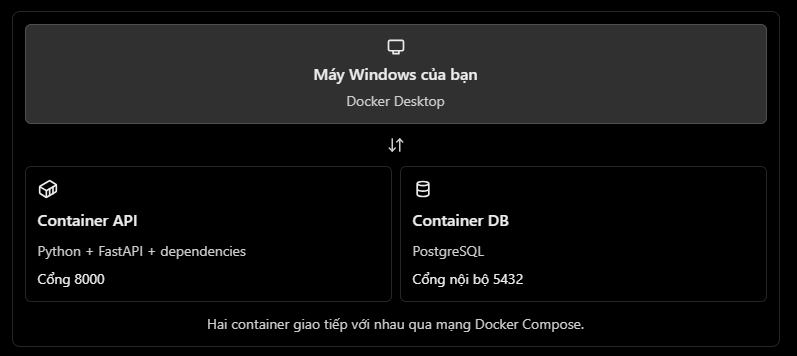

<p align="center" style="font-size: 30px">
    <b>
        Docker hóa FastAPI + PostgreSQL
    </b>
</p>

Ở bài trước, bạn đã xây dựng Authentication, RBAC và vòng đời `Access Token/Refresh Token`.  
Bây giờ, chúng ta chuyển sang một kỹ năng quan trọng của Backend Developer: đóng gói ứng dụng và database để có thể chạy ổn định trên các môi trường khác nhau.

Mục tiêu của bài học là chạy project `python-backend` bằng Docker Compose, gồm hai service:
- api: ứng dụng FastAPI.
- db: PostgreSQL.

# 1. Vì sao cần Docker?
Giả sử project của bạn chạy tốt trên máy Windows, nhưng khi đưa lên server lại gặp các vấn đề như khác phiên bản Python, thiếu thư viện hoặc chưa cài PostgreSQL.

Docker giúp đóng gói môi trường chạy để giảm sự khác biệt đó.



Liên hệ với Unity: bạn có thể hình dung Docker image như một gói môi trường đã được đóng gói, còn container là một instance đang chạy từ gói đó.  
Tuy nhiên, container không giống hoàn toàn với một máy ảo.

# 2. Kiểm tra môi trường
Trên Windows 11, cài Docker Desktop nếu chưa có, bật WSL 2 nếu trình cài đặt yêu cầu, sau đó mở PowerShell và chạy:

```powershell
docker --version
docker compose version
docker info
```
Nếu cả ba lệnh hoạt động bình thường, bạn có thể bắt đầu.

# 3. Bước 1 — Chuẩn bị các file Docker

Trong thư mục `D:\projects\python\python-backend`, tạo các file sau:
```
python-backend/
├── app/
├── tests/
├── Dockerfile
├── compose.yaml
├── .dockerignore
├── .env.docker
├── requirements.txt
└── .gitignore
```
## 3.1. Tạo `requirements.txt`

Nếu project đã có requirements.txt, hãy cập nhật file hiện tại, không ghi đè mù quáng.  
Nếu chưa có, tạo file với các dependency cơ bản phù hợp với code đã học:
```
fastapi
uvicorn[standard]
SQLAlchemy
psycopg[binary]
python-dotenv
pydantic[email]
pwdlib[argon2]
PyJWT
python-multipart
alembic
```
Sử dụng lệnh
```powershell
pip freeze > requirements.txt
```
Ở đây dùng PostgreSQL driver psycopg phiên bản 3.  
Nếu `app/database.py` của bạn đang dùng driver psycopg2, bạn cần thống nhất dependency và DATABASE_URL tương ứng trước khi chạy.

Để tạo file từ môi trường hiện tại, bạn cũng có thể chạy:
```powershell
python -m pip freeze > requirements.txt
```
Tuy nhiên, cách này sẽ ghi toàn bộ package đang cài trong .venv; về lâu dài nên giữ danh sách dependency trực tiếp của ứng dụng gọn và có kiểm soát phiên bản.

## 3.2. Tạo Dockerfile

Hướng dẫn: Về thư mục gốc của project, có thể dùng vs code tạo new file > Điền tên là `Dockerfile`; không có đuôi file
```dockerfile
FROM python:3.12-slim

ENV PYTHONDONTWRITEBYTECODE=1
ENV PYTHONUNBUFFERED=1

WORKDIR /app

COPY requirements.txt .
RUN pip install --no-cache-dir -r requirements.txt

COPY app ./app
COPY alembic.ini* ./

EXPOSE 8000

CMD ["uvicorn", "app.main:app", "--host", "0.0.0.0", "--port", "8000"]
```

Giải thích:
- FROM: chọn môi trường Python nền.
- WORKDIR: thư mục làm việc trong container.
- COPY: đưa source code vào image.
- RUN pip install: cài dependency.
- CMD: khởi chạy FastAPI.

`--host 0.0.0.0` rất quan trọng: nếu chỉ bind vào `127.0.0.1` bên trong container, cổng API có thể không truy cập được từ máy Windows.

Nếu bạn chưa có `alembic.ini`, dòng `COPY alembic.ini* ./` có thể không hoạt động như mong muốn tùy trình build. Trong trường hợp đó, hãy xóa dòng này; khi cấu hình migration, ta sẽ bổ sung file sau.

## 3.3. Tạo .dockerignore
```gitignore
.venv/
venv/
__pycache__/
*.py[cod]
.pytest_cache/
.mypy_cache/
.ruff_cache/
.git/
.env
.env.*
!.env.example
tests/
```
File này ngăn Docker đưa virtual environment, Git history và file môi trường chứa bí mật vào build context.

# 4. Bước 2 — Cấu hình biến môi trường

Tạo `.env.docker` ở thư mục gốc:
```dotenv
POSTGRES_DB=backend_learning
POSTGRES_USER=backend_user
POSTGRES_PASSWORD=replace_with_a_strong_local_password

DATABASE_URL=postgresql+psycopg://backend_user:replace_with_a_strong_local_password@db:5432/backend_learning

JWT_SECRET_KEY=replace_with_a_long_random_secret
JWT_ALGORITHM=HS256
ACCESS_TOKEN_EXPIRE_MINUTES=30
```
Thay hai giá trị mẫu bằng mật khẩu và secret riêng của bạn.  
Không dùng secret mẫu khi triển khai thật.

Có thể tạo một JWT secret ngẫu nhiên bằng PowerShell:
```powershell
python -c "import secrets; print(secrets.token_urlsafe(48))"
```
Lưu ý:
- Host db là tên service PostgreSQL trong Docker Compose.
- Port 5432 là cổng nội bộ của PostgreSQL container.
- DATABASE_URL phải tương thích với driver đã cài.
- Không commit .env.docker lên Git.

Bổ sung vào `.gitignore` nếu chưa có:

```gitignore
.env
.env.*
!.env.example
```

Nếu bạn đang chạy PostgreSQL trên Windows ở cổng `5432`, ta sẽ ánh xạ PostgreSQL container ra cổng `5433` để tránh xung đột.  
API container vẫn dùng cổng nội bộ `5432`.

# 5. Bước 3 — Tạo compose.yaml

Tạo file `compose.yaml` ở thư mục gốc:
```yaml
services:
  db:
    image: postgres:16
    restart: unless-stopped
    environment:
      POSTGRES_DB: ${POSTGRES_DB}
      POSTGRES_USER: ${POSTGRES_USER}
      POSTGRES_PASSWORD: ${POSTGRES_PASSWORD}
    ports:
      - "5433:5432"
    volumes:
      - postgres_data:/var/lib/postgresql/data
    healthcheck:
      test:
        [
          "CMD-SHELL",
          "pg_isready -U $${POSTGRES_USER} -d $${POSTGRES_DB}"
        ]
      interval: 5s
      timeout: 5s
      retries: 10

  api:
    build: .
    restart: unless-stopped
    env_file:
      - .env.docker
    ports:
      - "8000:8000"
    depends_on:
      db:
        condition: service_healthy

volumes:
  postgres_data:
```

Giải thích các phần quan trọng:
- image: postgres:16: sử dụng image PostgreSQL 16.
- ports: "5433:5432": máy Windows truy cập database qua cổng 5433; API container truy cập qua db:5432.
- postgres_data: lưu dữ liệu database trong Docker volume để dữ liệu không mất khi container bị xóa thông thường.
- healthcheck: kiểm tra PostgreSQL đã sẵn sàng nhận kết nối chưa.
- depends_on với service_healthy: chờ database khỏe trước khi khởi động API. Chỉ dùng depends_on thông thường thì chưa bảo đảm database đã sẵn sàng. 
  
Một điểm quan trọng: API container không được kết nối database bằng `localhost:5433`.  
Trong container API, localhost chỉ chính container API. Hãy dùng `db:5432`.

# 6. Bước 4 — Build và chạy ứng dụng
Mở PowerShell tại thư mục dự án:
```powershell
cd D:\projects\python\python-backend

docker compose --env-file .env.docker config
```
Result
```bash
PS D:\projects\python\python-backend> .venv\Scripts\activate
(.venv) PS D:\projects\python\python-backend> docker compose --env-file .env.docker config
name: python-backend
services:
  api:
    build:
      context: D:\projects\python\python-backend
      dockerfile: Dockerfile
    depends_on:
      db:
        condition: service_healthy
        required: true
    environment:
      ACCESS_TOKEN_EXPIRE_MINUTES: "30"
      DATABASE_URL: postgresql+psycopg://backend_user:123456@db:5432/backend_learning
      JWT_ALGORITHM: HS256
      JWT_SECRET_KEY: o2jH4R-0GmdbzLEXS5vP378Ulo3pFxEKQ-OuRAOXw5ViL8SQkEXF2ouXNLbriYiL
      POSTGRES_DB: backend_learning
      POSTGRES_PASSWORD: "123456"
      POSTGRES_USER: backend_user
    networks:
      default: null
    ports:
      - mode: ingress
        target: 8000
        published: "8000"
        protocol: tcp
    restart: unless-stopped
  db:
    environment:
      POSTGRES_DB: backend_learning
      POSTGRES_PASSWORD: "123456"
      POSTGRES_USER: backend_user
    healthcheck:
      test:
        - CMD-SHELL
        - pg_isready -U $${POSTGRES_USER} -d $${POSTGRES_DB}
      timeout: 5s
      interval: 5s
      retries: 10
    image: postgres:16
    networks:
      default: null
    ports:
      - mode: ingress
        target: 5432
        published: "5433"
        protocol: tcp
    restart: unless-stopped
    volumes:
      - type: volume
        source: postgres_data
        target: /var/lib/postgresql/data
        volume: {}
networks:
  default:
    name: python-backend_default
volumes:
  postgres_data:
    name: python-backend_postgres_data
```
Lệnh đầu tiên giúp kiểm tra cấu hình Compose.  
Chú ý không chia sẻ output nếu nó chứa thông tin bí mật.

Tiếp theo:
Lưu ý: Bật docker desktop trước khi chạy
```powershell
docker compose --env-file .env.docker up --build -d
```
Result
```bash
(.venv) PS D:\projects\python\python-backend> docker compose --env-file .env.docker up --build -d
[+] up 17/17
 ✔ Image postgres:16 Pulled                                                                                        12.6s
[+] Building 19.3s (13/13) FINISHED
 => [internal] load local bake definitions                                                                         0.0s
 => => reading from stdin 527B                                                                                     0.0s
 => [internal] load build definition from Dockerfile                                                               0.0s
 => => transferring dockerfile: 341B                                                                               0.0s
 => [internal] load metadata for docker.io/library/python:3.12-slim                                                2.7s
 => [internal] load .dockerignore                                                                                  0.0s
 => => transferring context: 166B                                                                                  0.0s
 => [1/6] FROM docker.io/library/python:3.12-slim@sha256:a6e34c598f2467ed0e9a8d349809fcd8b5c603269512df273a0bb178  1.5s
 => => resolve docker.io/library/python:3.12-slim@sha256:a6e34c598f2467ed0e9a8d349809fcd8b5c603269512df273a0bb178  0.0s
 => => extracting sha256:ecc510c1e359bdc007b39802570bb7e4dec7d6ebccf357c3201a74299113e05e                          0.5s
 => => sha256:bbc5a12237474ec0b23b5051260d56d6436a24d70d9cad961adebe7a037ed813 249B / 249B                         0.3s
 => => sha256:6912e23eb44595b44dc6d9882b34f305ad6f6e9667cec70b13e5dbc4f8cd97f4 12.12MB / 12.12MB                   1.2s
 => => sha256:75b6a36c64a1cf3520fc4b4aae4739d5caa8a6a05c27835a920a61784c9c32f8 1.29MB / 1.29MB                     1.1s
 => => extracting sha256:75b6a36c64a1cf3520fc4b4aae4739d5caa8a6a05c27835a920a61784c9c32f8                          0.1s
 => => extracting sha256:6912e23eb44595b44dc6d9882b34f305ad6f6e9667cec70b13e5dbc4f8cd97f4                          0.2s
 => => extracting sha256:bbc5a12237474ec0b23b5051260d56d6436a24d70d9cad961adebe7a037ed813                          0.0s
 => [internal] load build context                                                                                  0.1s
 => => transferring context: 112.16kB                                                                              0.1s
 => [2/6] WORKDIR /app                                                                                             0.2s
 => [3/6] COPY requirements.txt .                                                                                  0.0s
 => [4/6] RUN pip install --no-cache-dir -r requirements.txt                                                      12.3s
 => [5/6] COPY app ./app                                                                                           0.0s
 => [6/6] COPY alembic.ini* ./                                                                                     0.0s
 => exporting to image                                                                                             2.0s
 => => exporting layers                                                                                            1.3s
 => => exporting manifest sha256:5206c9d4daad6ea0ef8980f7237d16b138262b39118d72d3a5535b754702afed                  0.0s
 => => exporting config sha256:1b4d800074b7dd15bc3b28a522d05d082f109cf4a014db55f7961500b3e83a17                    0.0s
 => => exporting attestation manifest sha256:b44ab6786c7620d730fb6dc7c7286b9a0e1eebebbec05d5b84f520b0184d5a3a      0.0s
 => => exporting manifest list sha256:41276fa6fd4402e4ca075607ffeb7a7365ed37dc9b0e16513557b6e5502561e8             0.0s
 => => naming to docker.io/library/python-backend-api:latest                                                       0.0s
[+] up 22/22king to docker.io/library/python-backend-api:latest                                                    0.7s
 ✔ Image postgres:16                   Pulled                                                                      12.6s
 ✔ Image python-backend-api            Built                                                                       19.5s
 ✔ Network python-backend_default      Created                                                                      0.0s
 ✔ Volume python-backend_postgres_data Created                                                                      0.0s
 ✔ Container python-backend-db-1       Healthy                                                                      6.0s
 ✔ Container python-backend-api-1      Started                                                                      6.0s
```
Kiểm tra trạng thái
```powershell
docker compose ps
```
Result
```bash
(.venv) PS D:\projects\python\python-backend> docker compose ps
WARN[0000] The "POSTGRES_DB" variable is not set. Defaulting to a blank string.
WARN[0000] The "POSTGRES_USER" variable is not set. Defaulting to a blank string.
WARN[0000] The "POSTGRES_PASSWORD" variable is not set. Defaulting to a blank string.
NAME                   IMAGE                COMMAND                  SERVICE   CREATED         STATUS                          PORTS
python-backend-api-1   python-backend-api   "uvicorn app.main:ap…"   api       2 minutes ago   Restarting (1) 42 seconds ago
python-backend-db-1    postgres:16          "docker-entrypoint.s…"   db        2 minutes ago   Up 2 minutes (healthy)          0.0.0.0:5433->5432/tcp, [::]:5433->5432/tcp
```
Xem log API:
```bash
docker compose logs -f api
```
Đã gặp lỗi thiếu `email-validator`, nguyên nhân là 
- pip install 'pydantic[email]' cài thư viện vào .venv trên máy, nhưng container `api` cài dependencies từ `requirements.txt`. File này thiếu `email-validator`

```
PS D:\projects\python\python-backend> docker compose --env-file .env.docker logs -f api
api-1  | INFO:     Started server process [1]
api-1  | INFO:     Waiting for application startup.
api-1  | INFO:     Application startup complete.
api-1  | INFO:     Uvicorn running on http://0.0.0.0:8000 (Press CTRL+C to quit)
api-1  | INFO:     172.18.0.1:36926 - "GET / HTTP/1.1" 200 OK
```

Xem log PostgreSQL:
```powershell
docker compose logs -f db
```

Result
```
PS D:\projects\python\python-backend> docker compose logs -f db
WARN[0000] The "POSTGRES_DB" variable is not set. Defaulting to a blank string.
WARN[0000] The "POSTGRES_USER" variable is not set. Defaulting to a blank string.
WARN[0000] The "POSTGRES_PASSWORD" variable is not set. Defaulting to a blank string.
db-1  | The files belonging to this database system will be owned by user "postgres".
db-1  | This user must also own the server process.
db-1  |
db-1  | The database cluster will be initialized with locale "en_US.utf8".
db-1  | The default database encoding has accordingly been set to "UTF8".
db-1  | The default text search configuration will be set to "english".
db-1  |
db-1  | Data page checksums are disabled.
db-1  |
db-1  | fixing permissions on existing directory /var/lib/postgresql/data ... ok
db-1  | creating subdirectories ... ok
db-1  | selecting dynamic shared memory implementation ... posix
db-1  | selecting default max_connections ... 100
db-1  | selecting default shared_buffers ... 128MB
db-1  | selecting default time zone ... Etc/UTC
db-1  | creating configuration files ... ok
db-1  | running bootstrap script ... ok
db-1  | performing post-bootstrap initialization ... ok
db-1  | initdb: warning: enabling "trust" authentication for local connections
db-1  | initdb: hint: You can change this by editing pg_hba.conf or using the option -A, or --auth-local and --auth-host, the next time you run initdb.
db-1  | syncing data to disk ... ok
db-1  |
db-1  |
db-1  | Success. You can now start the database server using:
db-1  |
db-1  |     pg_ctl -D /var/lib/postgresql/data -l logfile start
db-1  |
db-1  | waiting for server to start....2026-10-17 14:47:12.069 UTC [48] LOG:  starting PostgreSQL 16.15 (Debian 16.15-1.pgdg13+2) on x86_64-pc-linux-gnu, compiled by gcc (Debian 14.2.0-19) 14.2.0, 64-bit
db-1  | 2026-10-17 14:47:12.070 UTC [48] LOG:  listening on Unix socket "/var/run/postgresql/.s.PGSQL.5432"
db-1  | 2026-10-17 14:47:12.075 UTC [51] LOG:  database system was shut down at 2026-10-17 14:47:11 UTC
db-1  | 2026-10-17 14:47:12.078 UTC [48] LOG:  database system is ready to accept connections
db-1  |  done
db-1  | server started
db-1  | CREATE DATABASE
db-1  |
db-1  |
db-1  | /usr/local/bin/docker-entrypoint.sh: ignoring /docker-entrypoint-initdb.d/*
db-1  |
db-1  | waiting for server to shut down...2026-10-17 14:47:12.218 UTC [48] LOG:  received fast shutdown request
db-1  | .2026-10-17 14:47:12.219 UTC [48] LOG:  aborting any active transactions
db-1  | 2026-10-17 14:47:12.220 UTC [48] LOG:  background worker "logical replication launcher" (PID 54) exited with exit code 1
db-1  | 2026-10-17 14:47:12.220 UTC [49] LOG:  shutting down
db-1  | 2026-10-17 14:47:12.221 UTC [49] LOG:  checkpoint starting: shutdown immediate
db-1  | 2026-10-17 14:47:12.261 UTC [49] LOG:  checkpoint complete: wrote 926 buffers (5.7%); 0 WAL file(s) added, 0 removed, 0 recycled; write=0.009 s, sync=0.028 s, total=0.041 s; sync files=301, longest=0.001 s, average=0.001 s; distance=4273 kB, estimate=4273 kB; lsn=0/191F0F8, redo lsn=0/191F0F8
db-1  | 2026-10-17 14:47:12.264 UTC [48] LOG:  database system is shut down
db-1  |  done
db-1  | server stopped
db-1  |
db-1  | PostgreSQL init process complete; ready for start up.
db-1  |
db-1  | 2026-10-17 14:47:12.332 UTC [1] LOG:  starting PostgreSQL 16.15 (Debian 16.15-1.pgdg13+2) on x86_64-pc-linux-gnu, compiled by gcc (Debian 14.2.0-19) 14.2.0, 64-bit
db-1  | 2026-10-17 14:47:12.332 UTC [1] LOG:  listening on IPv4 address "0.0.0.0", port 5432
db-1  | 2026-10-17 14:47:12.332 UTC [1] LOG:  listening on IPv6 address "::", port 5432
db-1  | 2026-10-17 14:47:12.334 UTC [1] LOG:  listening on Unix socket "/var/run/postgresql/.s.PGSQL.5432"
db-1  | 2026-10-17 14:47:12.337 UTC [64] LOG:  database system was shut down at 2026-10-17 14:47:12 UTC
db-1  | 2026-10-17 14:47:12.341 UTC [1] LOG:  database system is ready to accept connections
db-1  | 2026-10-17 14:52:12.424 UTC [62] LOG:  checkpoint starting: time
db-1  | 2026-10-17 14:52:16.657 UTC [62] LOG:  checkpoint complete: wrote 45 buffers (0.3%); 0 WAL file(s) added, 0 removed, 0 recycled; write=4.221 s, sync=0.008 s, total=4.236 s; sync files=12, longest=0.004 s, average=0.001 s; distance=261 kB, estimate=261 kB; lsn=0/1960530, redo lsn=0/19604F8
```

Nếu API khởi động thành công, mở:
- API health check
- Swagger UI

# 7. Bước 5 — Kết nối pgAdmin vào PostgreSQL trong Docker

Nếu muốn quản lý database Docker bằng pgAdmin, tạo một server connection mới với cấu hình:

Trường | Giá trị
|-|-|
Host name/address | localhost
Port | 5433
Maintenance database | backend_learning
Username | backend_user
Password | Mật khẩu trong .env.docker

Đây là kết nối từ Windows vào PostgreSQL container.  
Kết nối giữa hai container vẫn sử dụng hostname `db` và port `5432`.

Chú ý về dữ liệu hiện có: database PostgreSQL trong Docker là một database mới, không tự động chứa bảng users, posts hay `auth_sessions` từ PostgreSQL đã cài trên Windows.  
Để các endpoint CRUD và đăng nhập hoạt động, bạn cần áp dụng các migration `Alembic` vào database Docker.  
Nếu project chưa có migration thực sự, hãy hoàn thiện quy trình tạo migration trước khi sử dụng các endpoint cần database.

Không xóa volume để thử sửa lỗi kết nối, vì volume có thể chứa dữ liệu bạn cần giữ lại.

# 8. Các lệnh Docker cần nhớ
Lệnh | Tác dụng
|-|-|
docker compose ps | Xem các service đang chạy
docker compose logs -f api | Theo dõi log API
docker compose restart api | Khởi động lại API
docker compose down | Dừng và xóa container, network do Compose tạo
docker compose up --build -d | Build lại image và chạy nền
docker compose exec db psql -U backend_user -d backend_learning | Mở PostgreSQL shell trong container

`docker compose down` mặc định không xóa named volume.  
Tránh dùng `docker compose down -v` nếu chưa chủ động sao lưu hoặc không muốn xóa dữ liệu database.