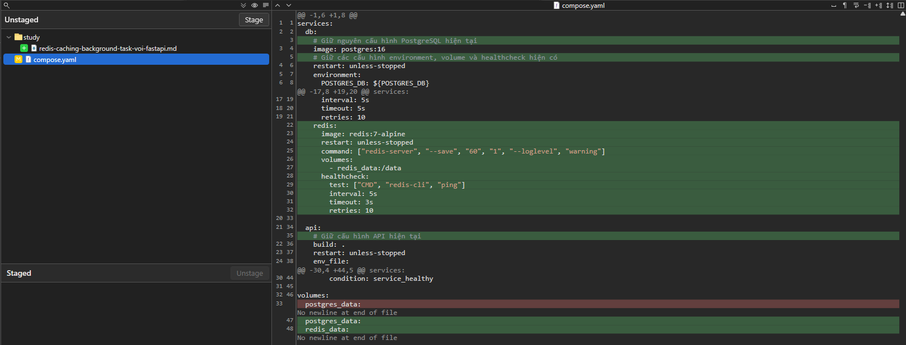

<p align="center" style="font-size: 30px">
    <b>
        Redis, Caching và Background Tasks với FastAPI
    </b>
</p>

Bạn đã đi từ Python cơ bản đến FastAPI, PostgreSQL, SQLAlchemy, Authentication, RBAC, Docker và CI.  
Bây giờ chúng ta bắt đầu một nhóm kiến thức quan trọng để xây dựng backend có khả năng xử lý nhiều request hơn: `Redis và xử lý tác vụ nền`.

Trong bài này, bạn sẽ học cách:
1. Hiểu Redis và khi nào nên dùng.
2. Tích hợp Redis vào FastAPI bằng Docker Compose.
3. Cache dữ liệu để giảm truy vấn PostgreSQL.
4. Xử lý vấn đề cache hết hạn và dữ liệu bị thay đổi.
5. Phân biệt BackgroundTasks với hệ thống hàng đợi như Celery hoặc RQ.

# 1. Redis là gì?
Redis là một hệ thống lưu trữ dữ liệu trong bộ nhớ, thường được sử dụng làm cache, bộ đếm, lưu trạng thái tạm thời và hỗ trợ hàng đợi tác vụ.

Hãy tưởng tượng API của bạn có endpoint `GET /users/123`. Mỗi lần request, ứng dụng phải truy vấn PostgreSQL để lấy thông tin user.

Không có cache:
```
Client gửi request
    ↓
FastAPI
    ↓
PostgreSQL truy vấn dữ liệu
```
Khi có cache:
```
Client gửi request
    ↓
FastAPI kiểm tra Redis
    ↓
_____________________________________________________________________________________
Cache HIT                         | Cache MISS
Có dữ liệu: trả về ngay từ cache. | Chưa có dữ liệu: truy vấn PostgreSQL rồi lưu vào Redis.
_____________________________________________________________________________________
```

Liên hệ với Unity: đây gần giống ý tưởng cache asset đã tải để tránh tải lại nhiều lần.  
Tuy nhiên, Redis thường cache dữ liệu backend như JSON, kết quả truy vấn, session hoặc counter; nó không thay thế PostgreSQL làm nguồn dữ liệu chính.

```
Nguyên tắc: PostgreSQL vẫn là nguồn dữ liệu chính. Redis chỉ giữ bản sao tạm thời mà ứng dụng có thể tái tạo.
```

# 2. Bước 1 — Thêm Redis vào Docker Compose
Trong project D:\projects\python\python-backend, mở compose.yaml và bổ sung service redis:
```yaml
services:
  db:
    # Giữ nguyên cấu hình PostgreSQL hiện tại
    image: postgres:16
    # Giữ các cấu hình environment, volume và healthcheck hiện có

  redis:
    image: redis:7-alpine
    restart: unless-stopped
    command: ["redis-server", "--save", "60", "1", "--loglevel", "warning"]
    volumes:
      - redis_data:/data
    healthcheck:
      test: ["CMD", "redis-cli", "ping"]
      interval: 5s
      timeout: 3s
      retries: 10

  api:
    # Giữ cấu hình API hiện tại
    build: .
    env_file:
      - .env.docker
    depends_on:
      db:
        condition: service_healthy
      redis:
        condition: service_healthy

volumes:
  postgres_data:
  redis_data:
```
Diff


Đây là cấu trúc minh họa các phần cần thêm; khi sửa file thật, `giữ nguyên những cấu hình hiện có` của db và api, đồng thời chỉ khai báo `volumes` một lần ở cấp cao nhất.

Redis không cần mở port ra Windows để API container sử dụng.  
Hai container giao tiếp với nhau qua hostname redis và cổng nội bộ 6379.

Trong `.env.docker`, thêm:
```dotenv
REDIS_URL=redis://redis:6379/0
```
Cài thư viện Redis cho Python:
```
.venv\Scripts\Activate.ps1
python -m pip install redis
```
Result
```bash
(.venv) PS D:\projects\python\python-backend> python -m pip install redis
Collecting redis
  Downloading redis-8.1.0-py3-none-any.whl.metadata (16 kB)
Downloading redis-8.1.0-py3-none-any.whl (560 kB)
   ━━━━━━━━━━━━━━━━━━━━━━━━━━━━━━━━━━━━━━━━ 560.6/560.6 kB 4.3 MB/s  0:00:00
Installing collected packages: redis
Successfully installed redis-8.1.0

[notice] A new release of pip is available: 26.1.2 -> 26.2.1
[notice] To update, run: python.exe -m pip install --upgrade pip
```
Sau đó cập nhật requirements.txt để có dependency redis.
Khởi động lại stack:
```powershell
docker compose --env-file .env.docker up --build -d
```
Result
```
(.venv) PS D:\projects\python\python-backend> docker compose --env-file .env.docker up --build -d
[+] Building 1.3s (16/16) FINISHED
 => [internal] load local bake definitions                                                                                                                                                              0.0s
 => => reading from stdin 527B                                                                                                                                                                          0.0s
 => [internal] load build definition from Dockerfile                                                                                                                                                    0.0s
 => => transferring dockerfile: 419B                                                                                                                                                                    0.0s
 => [internal] load metadata for docker.io/library/python:3.12-slim                                                                                                                                     0.8s
 => [internal] load .dockerignore                                                                                                                                                                       0.0s
 => => transferring context: 166B                                                                                                                                                                       0.0s
 => [1/9] FROM docker.io/library/python:3.12-slim@sha256:a6e34c598f2467ed0e9a8d349809fcd8b5c603269512df273a0bb1784edc11b1                                                                               0.0s
 => => resolve docker.io/library/python:3.12-slim@sha256:a6e34c598f2467ed0e9a8d349809fcd8b5c603269512df273a0bb1784edc11b1                                                                               0.0s
 => [internal] load build context                                                                                                                                                                       0.0s
 => => transferring context: 4.25kB                                                                                                                                                                     0.0s
 => CACHED [2/9] WORKDIR /app                                                                                                                                                                           0.0s
 => CACHED [3/9] COPY requirements.txt .                                                                                                                                                                0.0s
 => CACHED [4/9] RUN pip install --no-cache-dir -r requirements.txt                                                                                                                                     0.0s
 => CACHED [5/9] COPY app ./app                                                                                                                                                                         0.0s
 => CACHED [6/9] COPY models ./models                                                                                                                                                                   0.0s
 => CACHED [7/9] COPY services ./services                                                                                                                                                               0.0s
 => CACHED [8/9] COPY migrations ./migrations                                                                                                                                                           0.0s
 => CACHED [9/9] COPY alembic.ini* ./                                                                                                                                                                   0.0s
 => exporting to image                                                                                                                                                                                  0.1s
 => => exporting layers                                                                                                                                                                                 0.0s
 => => exporting manifest sha256:4be97c006c1827149635b1859cf7c5b1327c64504d453189503d031963af1da5                                                                                                       0.0s
 => => exporting config sha256:857ca90f9d13b20302ecc0919995a6a1a78f1de37df380cef69eb50c20f0853a                                                                                                         0.0s
 => => exporting attestation manifest sha256:45d56a79187d9f73d0387960cd5667b03203d890381da10a9a7d00739dab04e0                                                                                           0.0s
 => => exporting manifest list sha256:96bcf817ea51bba2077c46967d31c10a5ec9995d41dd4bbfc36034a6779a02f5                                                                                                  0.0s
 => => naming to docker.io/library/python-backend-api:latest                                                                                                                                            0.0s
 => => unpacking to docker.io/library/python-backend-api:latest                                                                                                                                         0.0s
 => resolving provenance for metadata file                                                                                                                                                              0.0s
[+] up 4/4
 ✔ Image python-backend-api         Built                                                                                                                                                                1.4s
 ✔ Container python-backend-redis-1 Healthy                                                                                                                                                              1.0s
 ✔ Container python-backend-api-1   Running                                                                                                                                                              0.0s
 ✔ Container python-backend-db-1    Healthy
```
Kiểm tra Redis:
```powershell
docker compose exec redis redis-cli ping
```
Result
```bash
(.venv) PS D:\projects\python\python-backend> docker compose exec redis redis-cli ping
WARN[0000] The "POSTGRES_DB" variable is not set. Defaulting to a blank string.
WARN[0000] The "POSTGRES_USER" variable is not set. Defaulting to a blank string.
WARN[0000] The "POSTGRES_PASSWORD" variable is not set. Defaulting to a blank string.
PONG
```
Kết quả mong đợi:
```bash
PONG
```
# 3. Bước 2 — Tạo kết nối Redis trong ứng dụng
Tạo file `app/redis_client.py`:
```py
import os

import redis
from redis.exceptions import RedisError

REDIS_URL = os.getenv("REDIS_URL", "redis://localhost:6379/0")

redis_client = redis.Redis.from_url(
    REDIS_URL,
    decode_responses=True,
    socket_connect_timeout=2,
    socket_timeout=2,
)
```
Ở đây dùng Redis client đồng bộ để phù hợp với cách bạn đang sử dụng SQLAlchemy Session đồng bộ.
- `decode_responses=True`: kết quả trả về là chuỗi Python thay vì bytes.
- `socket_connect_timeout`: giới hạn thời gian chờ kết nối.
- `socket_timeout`: tránh request bị treo quá lâu khi Redis phản hồi chậm.

Khi chạy bên trong Docker, ứng dụng sẽ dùng `redis://redis:6379/0`.  
Khi chạy trực tiếp trên Windows, bạn cần một Redis có thể truy cập tại URL được cấu hình.

# 4. Bước 3 — Xây dựng cache cho API lấy user
Ta sẽ dùng ví dụ `GET /users/{user_id}`.  
Bạn có thể tích hợp phần cache vào router hiện có hoặc Service Layer của project.

Tạo file `app/cache.py`:
```py
import json

from app.redis_client import redis_client

def get_cached_json(key: str):
    raw = redis_client.get(key)

    if raw is None:
        return None

    return json.loads(raw)

def set_cached_json(key: str, value: dict, ttl_seconds: int = 60):
    redis_client.set(
        key,
        json.dumps(value),
        ex=ttl_seconds,
    )

def delete_cache(key: str):
    redis_client.delete(key)
```
Cache này lưu dữ liệu JSON với thời hạn mặc định 60 giây.

Ví dụ, key có thể là:
```
user:123
```
Và value:
```json
{
  "id": 123,
  "name": "Nguyen Van A",
  "email": "example@example.com"
}
```
Không cache trực tiếp SQLAlchemy ORM object bằng `json.dumps()`: ORM object không mặc định chuyển thành JSON được.  
Hãy chuyển thành dictionary hoặc Pydantic schema trước.

## Cách tích hợp vào endpoint

Trong router lấy user hiện có, bạn có thể áp dụng logic sau.  
Ví dụ này giả định bạn có `UserRead` là Pydantic schema với `from_attributes=True`, và `db.get(User, user_id)` là cách truy vấn user hiện tại:

```py
from fastapi import Depends, HTTPException
from sqlalchemy.orm import Session

from app.cache import get_cached_json, set_cached_json
from app.dependencies import get_db
from app.models import User
from app.schemas import UserRead

@router.get("/{user_id}", response_model=UserRead)
def get_user(
    user_id: int,
    db: Session = Depends(get_db),
):
    cache_key = f"user:{user_id}"

    try:
        cached = get_cached_json(cache_key)
    except (ValueError, TypeError):
        cached = None

    if cached is not None:
        return cached

    user = db.get(User, user_id)

    if user is None:
        raise HTTPException(
            status_code=404,
            detail="User not found",
        )

    result = UserRead.model_validate(user).model_dump(mode="json")

    try:
        set_cached_json(cache_key, result, ttl_seconds=60)
    except (TypeError, ValueError):
        pass

    return result
```
Đây là phần minh họa cache cho endpoint.  
Khi tích hợp vào project thật, giữ nguyên router, schema và các quy tắc quyền truy cập hiện tại.  
Đặc biệt, với dữ liệu riêng tư, cần phân biệt cache dùng chung với cache theo người dùng; không để dữ liệu của user này được trả cho user khác.

Ngoài ra, code trên mới xử lý lỗi chuyển đổi JSON.  
Trong production, bạn nên bắt RedisError riêng cho thao tác đọc/ghi cache để API vẫn có thể truy vấn PostgreSQL nếu Redis tạm thời không hoạt động.

# 5. Bước 4 — Xử lý cache khi dữ liệu thay đổi
Đây là phần quan trọng nhất khi sử dụng cache: cache invalidation — làm sao để cache không trả về dữ liệu cũ sau khi database đã thay đổi?

Giả sử user 123 đổi tên từ Nguyen Van A thành Nguyen Van B.  
PostgreSQL đã cập nhật tên mới, nhưng Redis vẫn giữ dữ liệu cũ trong tối đa 60 giây.

Cách đơn giản là xóa cache sau khi cập nhật thành công.  
Sửa `app/services/user_service.py` hàm `update_user`
```py
from redis.exceptions import RedisError
from app.cache import delete_cache

# Sau khi cập nhật user và transaction đã commit thành công:
db.commit()
db.refresh(user)

try:
    delete_cache(f"user:{user.id}")
except RedisError:
    pass
```
Đoạn trên là phần logic cần tích hợp vào endpoint hoặc service cập nhật user hiện có, không phải endpoint độc lập.

Lưu ý: nếu Redis lỗi, việc xóa cache có thể thất bại và dữ liệu cũ còn tồn tại đến khi TTL hết hạn.  
Với ứng dụng yêu cầu tính nhất quán cao, bạn cần chiến lược mạnh hơn, chẳng hạn versioned cache keys, ghi nhận sự kiện invalidation hoặc không dùng cache cho dữ liệu đó.

Khi nào cần xóa cache?
Thao tác | Hành động
|-|-|
Đọc user | Đọc cache trước, nếu thiếu thì truy vấn DB
Cập nhật user | Xóa cache sau khi commit
Xóa user | Xóa cache sau khi commit
Tạo user mới | Thường chưa có cache để xóa
Thay đổi quyền hoặc dữ liệu riêng tư | Xem xét cache riêng theo user hoặc không cache

Một nguyên tắc cần nhớ: `không xóa cache trước khi database commit thành công`, nếu không cache có thể được tạo lại từ dữ liệu cũ.

# 6. Bước 5 — Khi Redis không hoạt động thì sao?
Redis nên là lớp tối ưu hiệu năng, không phải điểm lỗi khiến API ngừng phục vụ những request vẫn có thể xử lý bằng PostgreSQL.

Với cache không bắt buộc, hãy xử lý lỗi đọc/ghi Redis như sau:
```py
from redis.exceptions import RedisError

def safe_get_cache(key: str):
    try:
        return get_cached_json(key)
    except (RedisError, ValueError, TypeError):
        return None


def safe_set_cache(key: str, value: dict, ttl_seconds: int = 60):
    try:
        set_cached_json(key, value, ttl_seconds)
    except (RedisError, ValueError, TypeError):
        pass
```
Sau đó endpoint có thể dùng `safe_get_cache()` và `safe_set_cache()` thay cho hàm trực tiếp.

Cách này cho phép API fallback về PostgreSQL khi cache bị lỗi.  
Tuy nhiên, cần log lỗi có kiểm soát để đội phát triển phát hiện Redis đang gặp vấn đề; đừng âm thầm bỏ qua lỗi vô thời hạn.

Không phải dữ liệu nào cũng nên cache.  
Ví dụ, số dư tài khoản hoặc quyền truy cập nhạy cảm cần được thiết kế cẩn thận hơn vì dữ liệu cũ có thể gây hậu quả nghiêm trọng.

# 7. Bước 6 — Background Tasks trong FastAPI
Cache giúp request trả lời nhanh hơn.  
Nhưng nếu một request còn phải gửi email, ghi log phân tích hoặc tạo báo cáo, bạn có thể không muốn bắt client chờ tất cả công việc đó hoàn tất.

FastAPI cung cấp `BackgroundTasks` cho những tác vụ đơn giản sau khi response được gửi đi.

Ví dụ tạo file `app/routers/notifications.py`:
```py
from fastapi import APIRouter, BackgroundTasks

router = APIRouter(prefix="/notifications", tags=["notifications"])

def write_notification_log(message: str) -> None:
    with open("notifications.log", "a", encoding="utf-8") as file:
        file.write(message + "\n")

@router.post("/test")
def create_notification(
    background_tasks: BackgroundTasks,
):
    background_tasks.add_task(
        write_notification_log,
        "Notification requested",
    )

    return {"message": "Notification accepted"}
```
Đăng ký router trong `app/main.py`:
```py
from app.routers.notifications import router as notifications_router

app.include_router(notifications_router)
```
Gọi `POST /notifications/test`.  
API trả response mà không cần chờ thao tác ghi log được thực hiện xong.

Ví dụ này chỉ để học cơ chế; khi chạy nhiều worker hoặc nhiều container, ghi vào một file cục bộ không phải cách lưu log đáng tin cậy.

File notification.log được tạo ra ở root project

`BackgroundTasks` khác Celery/RQ như thế nào?
```
FastAPI BackgroundTasks

Phù hợp với tác vụ nhẹ, đơn giản, gắn với vòng đời xử lý request. Không cung cấp hàng đợi bền vững độc lập.
Ví dụ: ghi log đơn giản hoặc gửi một thông báo không quan trọng.
```
```
Celery / RQ + Redis

Phù hợp với tác vụ nặng, cần worker riêng, retry, theo dõi trạng thái và xử lý độc lập với API.
Ví dụ: gửi hàng loạt email, xử lý ảnh, xuất báo cáo lớn hoặc xử lý job lâu.
```

Lưu ý: Redis không tự động biến BackgroundTasks thành một hàng đợi công việc bền vững.  
Nếu cần job không bị mất khi API process dừng đột ngột, hãy dùng một hệ thống task queue phù hợp.

9. Tổng kết kiến thức

Thành phần | Vai trò
|-|-|
PostgreSQL | Lưu trữ dữ liệu chính
Redis | Cache và lưu dữ liệu tạm thời
TTL | Giới hạn thời gian dữ liệu cache tồn tại
Cache invalidation | Xóa hoặc vô hiệu hóa cache khi dữ liệu thay đổi
FastAPI BackgroundTasks | Thực hiện tác vụ nhẹ sau response
Celery/RQ | Xử lý tác vụ qua worker và hàng đợi riêng